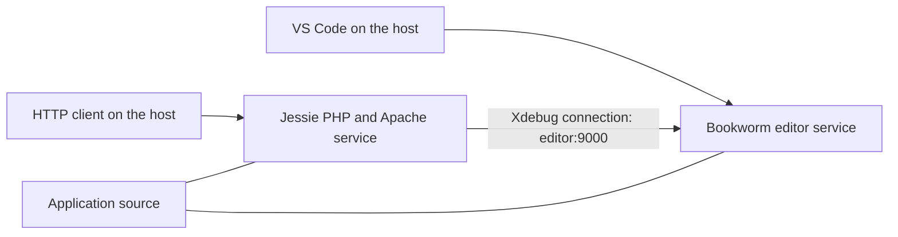

## More than a PHP container

A PHP process running in a container is only part of a usable development environment. The editor must connect, the debugger must reach it, source paths must agree, and a breakpoint must actually stop the request.

That distinction shaped a small catalog of Dev Container templates for PHP 5.1.6, PHP 5.4, and PHP 8.5. The goal was to give developers a repeatable way to maintain legacy projects while working toward a modern runtime, without asking every developer to reconstruct an old PHP toolchain on the host.

The result is a [public template repository](https://github.com/guionardo/devcontainer-templates), three OCI templates, a shell installer, and three minimal projects that were tested with real breakpoints in VS Code. This article explains the design and the checks that made the result credible.

## A template catalog with a clear boundary

The repository contains environment configuration, technical checks, and tiny PHP examples. Application code and business regression tests stay in their own repositories.

This boundary matters during modernization. Successfully executing a calculation on PHP 5.1 and PHP 8.5 proves something useful about the environment. It does not prove that an application's database queries, framework, dependencies, or business rules behave identically.

Each runtime has its own directory under `src/`, containing `devcontainer-template.json`, `.devcontainer/devcontainer.json`, a Dockerfile, and debug configuration. The legacy templates also contain a Compose file. These files can be applied to an existing project, so developers can keep the environment configuration alongside their application.

## Why the legacy editor needs its own container

The legacy builds use Debian Jessie. Modern VS Code Server binaries require system libraries newer than that environment provides, including glibc 2.28 or later. Microsoft's [Linux requirements](https://code.visualstudio.com/docs/remote/linux) describe that boundary.

The solution was to separate the roles:

- A modern Bookworm `editor` service runs VS Code Server and PHP Debug.
- A `php` service runs the historical PHP version and Apache.
- Both services mount the application at `/var/www/html`.
- Xdebug connects from the runtime to `editor:9000` over the Compose network.



Keeping the mount path identical simplifies source mapping. Keeping the editor current avoids forcing an old operating system to satisfy the editor's library requirements.

There is one visible tradeoff: the legacy integrated terminal belongs to the editor service and has no PHP interpreter. Runtime commands are executed from the host:

```sh
docker compose -f .devcontainer/compose.yaml exec php php -v
```

The PHP 8.5 environment can host both roles in the same container, so its integrated terminal contains PHP and Xdebug connects locally on port 9003.

## Treat the PHP SAPI and source downloads as explicit choices

PHP 5.1.6 uses CGI in this setup. Its historical Apache module is not suitable for the selected Apache 2.4 configuration. The CLI executable and the CGI executable must be copied from the correct build outputs; an executable named `php` is not enough information to determine its role.

PHP 5.4.45 uses an Apache module with the prefork MPM. The modern environment uses the official PHP 8.5 Apache image.

Source downloads were another compatibility boundary. The old distribution's TLS client could not negotiate with the Xdebug download endpoint. A separate modern curl stage downloads the historical PHP and Xdebug archives with certificate verification, then passes them to the legacy build stage.

That solves a concrete download failure. It does not make the entire build reproducible. The repository still needs pinned archive checksums, pinned image digests, and dependency validation without cached layers. Those limits belong in the documentation rather than being hidden behind a successful build badge.

## Xdebug connects to the editor

The network model becomes easier to reason about once the connection direction is explicit. The PHP runtime initiates the debugger connection, and PHP Debug listens for it.

For the legacy layout, `host.docker.internal` would point toward the host rather than the editor service. The configured destination is therefore `editor:9000`. The listener binds inside that service, and the shared workspace path is mapped to the editor's workspace.

For PHP 8.5, the editor and runtime share a container. Xdebug connects to `127.0.0.1:9003`. Requests use `?XDEBUG_TRIGGER=1` to opt into debugging. The selected legacy configurations start their Xdebug connections automatically.

None of these layouts requires explicitly publishing a debugger port on the host. The host needs access to the HTTP server; the debugger connection remains within the relevant container network or container.

## Distribute configuration through a standard format

Copying a `.devcontainer` folder is useful for a first experiment. A team needs a clear version and a repeatable installation path.

Dev Container Templates provide that format. The [official CLI](https://github.com/devcontainers/cli/blob/main/docs/templates/apply.md) can download an OCI template into an existing project:

```sh
npx @devcontainers/cli templates apply --workspace-folder . --template-id ghcr.io/guionardo/devcontainer-templates/php-5.4:0.1.0
```

The suffix selects the template release. It is separate from the PHP version and from the CLI version downloaded by npx. After applying, the developer opens the application in VS Code and chooses **Dev Containers: Reopen in Container**.

The published packages contain configuration files, not prebuilt PHP images. The first use still builds the runtime locally. Publishing prebuilt images could reduce that cost, but would add another release artifact to maintain.

Three templates produce four packages in GHCR: one per runtime and one collection metadata package. The extra package supports discovery; it is not an accidental fourth PHP environment. This behavior is described in the [official template starter](https://github.com/devcontainers/template-starter#publishing).

## An installer for existing, customized projects

The catalog also provides a shell installer:

```sh
curl -fsSL https://raw.githubusercontent.com/guionardo/devcontainer-templates/main/scripts/install.sh | sh -s -- --php 5.4 --smoke
```

It can be run from Git Bash, WSL, Linux, or macOS. Developers can also download and inspect the script before executing it.

An installer must account for existing configuration. This one refuses an existing `.devcontainer` directory unless `--update` is supplied. Updates create a backup, replace known template files, preserve `.env` and custom files, and leave an existing `launch.json` intact. A candidate debug configuration is written separately for manual merging.

This is intentionally a limited update strategy. It does not attempt to merge arbitrary JSONC or preserve custom edits inside a Dockerfile that is being replaced. Those edits must be reviewed and reapplied from the backup. The official CLI is a separate installation path and should not be described as providing these custom safeguards.

The installer uses Git source and defaults to `main`. That can differ from the latest OCI release. A fixed tag or commit, used for both the script URL and its `--ref` argument, makes the selected source revision explicit.

## Release packages from tags

The repository uses a coordinated version for all three templates. That is a project convention; the underlying specification also supports independent template versions.

A tag such as `v1.0.0` starts publication only if all three metadata files declare `1.0.0` and the tagged commit belongs to `main` history. The workflow first runs the release validator, installer tests, JSON checks, and Compose validation, then invokes the official publication action with package write permission.

For a prepared release, the maintainer runs:

```sh
node scripts/validate-release.cjs v1.0.0
git tag -a v1.0.0 -m "Release Dev Container Templates 1.0.0"
git push origin v1.0.0
```

The `1.0.0` milestone consolidates the English catalog and release automation; the manual results discussed here belong to the published `0.1.0` baseline. A documentation edit is not a reason to silently replace an existing package version.

## What the manual test actually established

The end-to-end check used VS Code 1.143.1 on Windows x64 with Docker Desktop in Linux mode. The published OCI packages were downloaded using the official CLI bundled with the Dev Containers extension. PHP Debug 1.40.2 installed automatically in each editor container.

| Runtime | Xdebug | HTTP response | Breakpoint, variables, and F10 |
| --- | --- | --- | --- |
| PHP 5.1.6 | 2.0.0 | Passed | Passed |
| PHP 5.4.45 | 2.4.1 | Passed | Passed |
| PHP 8.5.12 | 3.5.3 | Passed | Passed |

Each minimal application computes a subtotal of 50, applies a discount of 5, and returns 45. The breakpoint was placed before the subtraction. VS Code stopped at line 7; the local variables showed the expected inputs. F10 advanced to line 8 and exposed total 45. F5 completed the request and returned the PHP version, Xdebug version, and calculation result.

This exercised more than a debugger configuration file. It demonstrated the runtime-to-editor connection, source mapping, breakpoint resolution, stack frames, variable inspection, stepping, and continuation of an actual HTTP request.

The [report and evidence](https://github.com/guionardo/devcontainer-templates/blob/main/examples/vscode-debug/RESULTS.md) distinguish the original manual session from later English identifier changes. This matters: editing a report should not manufacture a new test run.

## A useful environment still has limits

These environments support isolated local maintenance. Unsupported PHP and Debian versions do not become suitable for production because they run in Docker. The PHP 5.1.6 baseline also has no MySQL driver enabled, so an application may need additional work even when the minimal debugger example succeeds.

CI currently validates configuration, installer behavior, and release rules. It does not operate the VS Code GUI or claim to replace application regression tests. Other platforms and architectures need their own validation.

The most useful outcome is a smaller, explicit set of assumptions: which runtime is selected, where the editor runs, which direction the debugger connects, what a template version contains, and which checks have actually passed. Developers can then spend more time investigating application behavior and less time reconstructing the environment around it.

## References

- [Repository and templates](https://github.com/guionardo/devcontainer-templates)
- [VS Code Linux requirements](https://code.visualstudio.com/docs/remote/linux)
- [Dev Container Template specification](https://containers.dev/implementors/templates/)
- [Official CLI: apply a template](https://github.com/devcontainers/cli/blob/main/docs/templates/apply.md)
- [Template authoring and metadata packages](https://github.com/devcontainers/template-starter)
- [Publication action](https://github.com/devcontainers/action)
