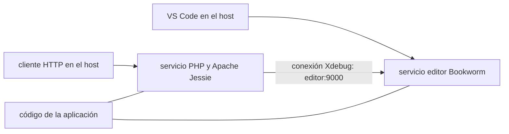

## Más que un contenedor PHP

Un proceso PHP ejecutándose en un contenedor es solo una parte de un entorno de desarrollo utilizable. El editor debe conectarse, el depurador debe alcanzarlo, las rutas de las fuentes deben coincidir y un breakpoint debe detener realmente la solicitud.

Esa distinción dio forma a un pequeño catálogo de templates de Dev Containers para PHP 5.1.6, PHP 5.4 y PHP 8.5. El objetivo era ofrecer una forma repetible de mantener proyectos heredados mientras se avanza hacia un runtime moderno, sin pedir a cada desarrollador que reconstruya una toolchain antigua de PHP en el host.

El resultado es un [repositorio público de templates](https://github.com/guionardo/devcontainer-templates), tres templates OCI, un instalador shell y tres proyectos mínimos probados con breakpoints reales en VS Code. Este artículo explica el diseño y las comprobaciones que hicieron creíble el resultado.

## Un catálogo de templates con un límite claro

El repositorio contiene configuración del entorno, comprobaciones técnicas y pequeños ejemplos en PHP. El código de la aplicación y las pruebas de regresión de negocio permanecen en sus propios repositorios.

Este límite importa durante la modernización. Ejecutar correctamente un cálculo en PHP 5.1 y PHP 8.5 demuestra algo útil sobre el entorno. No demuestra que las consultas a la base de datos, el framework, las dependencias o las reglas de negocio de una aplicación se comporten de forma idéntica.

Cada runtime tiene su propio directorio en `src/`, con `devcontainer-template.json`, `.devcontainer/devcontainer.json`, un Dockerfile y configuración de debug. Los templates heredados también contienen un archivo Compose. Estos archivos pueden aplicarse a un proyecto existente, para que los desarrolladores mantengan la configuración del entorno junto a su aplicación.

## Por qué el editor heredado necesita su propio contenedor

Los builds heredados usan Debian Jessie. Los binarios modernos de VS Code Server requieren bibliotecas del sistema más nuevas que las proporcionadas por ese entorno, incluida glibc 2.28 o posterior. Los [requisitos de Linux de Microsoft](https://code.visualstudio.com/docs/remote/linux) describen ese límite.

La solución fue separar las funciones:

- Un servicio `editor` moderno basado en Bookworm ejecuta VS Code Server y PHP Debug.
- Un servicio `php` ejecuta la versión histórica de PHP y Apache.
- Ambos servicios montan la aplicación en `/var/www/html`.
- Xdebug se conecta desde el runtime a `editor:9000` mediante la red de Compose.



Mantener idéntica la ruta de montaje simplifica el mapeo de fuentes. Mantener actualizado el editor evita obligar a un sistema operativo antiguo a satisfacer los requisitos de bibliotecas del editor.

Hay una desventaja visible: el terminal integrado heredado pertenece al servicio `editor` y no tiene un intérprete PHP. Los comandos del runtime se ejecutan desde el host:

```sh
docker compose -f .devcontainer/compose.yaml exec php php -v
```

El entorno PHP 8.5 puede alojar ambas funciones en el mismo contenedor, por lo que su terminal integrado contiene PHP y Xdebug se conecta localmente al puerto 9003.

## Tratar el SAPI de PHP y las descargas de fuentes como decisiones explícitas

PHP 5.1.6 usa CGI en esta configuración. Su módulo histórico de Apache no es adecuado para la configuración seleccionada de Apache 2.4. Los ejecutables CLI y CGI deben copiarse de los artefactos de build correctos; un ejecutable llamado `php` no proporciona suficiente información para determinar su función.

PHP 5.4.45 usa un módulo de Apache con el MPM prefork. El entorno moderno usa la imagen oficial de PHP 8.5 con Apache.

Las descargas de fuentes fueron otro límite de compatibilidad. El cliente TLS de la distribución antigua no podía negociar con el endpoint de descarga de Xdebug. Una etapa separada con curl moderno descarga los archivos de PHP histórico y Xdebug con verificación de certificados y los pasa a la etapa de build heredada.

Eso resuelve un fallo concreto de descarga. No hace reproducible todo el build. El repositorio todavía necesita checksums fijados de los archivos, digests fijados de las imágenes y validación de dependencias sin capas en caché. Esos límites deben estar en la documentación, en lugar de ocultarse detrás de un badge de build exitoso.

## Xdebug se conecta al editor

El modelo de red resulta más fácil de razonar cuando la dirección de la conexión es explícita. El runtime PHP inicia la conexión con el depurador y PHP Debug la escucha.

En el diseño heredado, `host.docker.internal` apuntaría al host y no al servicio editor. Por eso, el destino configurado es `editor:9000`. El listener se enlaza dentro de ese servicio y la ruta compartida del workspace se mapea al workspace del editor.

En PHP 8.5, el editor y el runtime comparten un contenedor. Xdebug se conecta a `127.0.0.1:9003`. Las solicitudes usan `?XDEBUG_TRIGGER=1` para activar el debug. Las configuraciones heredadas seleccionadas inician automáticamente sus conexiones de Xdebug.

Ninguno de estos diseños requiere publicar explícitamente un puerto de depuración en el host. El host necesita acceder al servidor HTTP; la conexión del depurador permanece dentro de la red de contenedores o del contenedor correspondiente.

## Distribuir la configuración mediante un formato estándar

Copiar una carpeta `.devcontainer` es útil para un primer experimento. Un equipo necesita una versión clara y un proceso de instalación repetible.

Dev Container Templates proporciona ese formato. La [CLI oficial](https://github.com/devcontainers/cli/blob/main/docs/templates/apply.md) puede descargar un template OCI en un proyecto existente:

```sh
npx @devcontainers/cli templates apply --workspace-folder . --template-id ghcr.io/guionardo/devcontainer-templates/php-5.4:0.1.0
```

El sufijo selecciona la versión del template. Es independiente de la versión de PHP y de la versión de la CLI descargada por npx. Después de aplicarlo, el desarrollador abre la aplicación en VS Code y elige **Dev Containers: Reopen in Container**.

Los paquetes publicados contienen archivos de configuración, no imágenes PHP preconstruidas. El primer uso todavía construye el runtime localmente. Publicar imágenes preconstruidas podría reducir ese coste, pero añadiría otro artefacto de release que mantener.

Los tres templates producen cuatro paquetes en GHCR: uno por runtime y uno de metadatos de la colección. El paquete adicional permite el descubrimiento; no es un cuarto entorno PHP accidental. Este comportamiento se describe en el [template starter oficial](https://github.com/devcontainers/template-starter#publishing).

## Un instalador para proyectos existentes y personalizados

El catálogo también proporciona un instalador shell:

```sh
curl -fsSL https://raw.githubusercontent.com/guionardo/devcontainer-templates/main/scripts/install.sh | sh -s -- --php 5.4 --smoke
```

Puede ejecutarse desde Git Bash, WSL, Linux o macOS. Los desarrolladores también pueden descargar e inspeccionar el script antes de ejecutarlo.

Un instalador debe tener en cuenta la configuración existente. Este rechaza un directorio `.devcontainer` existente a menos que se indique `--update`. Las actualizaciones crean una copia de seguridad, reemplazan los archivos conocidos del template, conservan `.env` y los archivos personalizados, y dejan intacto un `launch.json` existente. Una configuración de debug candidata se escribe por separado para combinarla manualmente.

Esta es intencionadamente una estrategia de actualización limitada. No intenta combinar JSONC arbitrario ni conservar ediciones personalizadas dentro de un Dockerfile que será reemplazado. Esas ediciones deben revisarse y reaplicarse desde la copia de seguridad. La CLI oficial es una vía de instalación separada y no debe describirse como si ofreciera estas salvaguardas personalizadas.

El instalador usa una fuente Git y toma `main` por defecto. Eso puede diferir de la última versión OCI. Una tag o commit fijo, usado tanto para la URL del script como para su argumento `--ref`, hace explícita la revisión de fuente seleccionada.

## Publicar paquetes a partir de tags

El repositorio usa una versión coordinada para los tres templates. Es una convención del proyecto; la especificación subyacente también admite versiones independientes por template.

Una tag como `v1.0.0` inicia la publicación solo si los tres archivos de metadatos declaran `1.0.0` y el commit marcado pertenece al historial de `main`. El workflow ejecuta primero el validador de release, las pruebas del instalador, las comprobaciones JSON y la validación de Compose; después invoca la acción oficial de publicación con permiso de escritura en paquetes.

Para un release preparado, el mantenedor ejecuta:

```sh
node scripts/validate-release.cjs v1.0.0
git tag -a v1.0.0 -m "Release Dev Container Templates 1.0.0"
git push origin v1.0.0
```

El hito `1.0.0` consolida el catálogo en inglés y la automatización de releases; los resultados manuales tratados aquí pertenecen a la baseline publicada `0.1.0`. Una modificación de documentación no es razón para reemplazar silenciosamente una versión de paquete existente.

## Qué estableció realmente la prueba manual

La comprobación de extremo a extremo usó VS Code 1.143.1 en Windows x64 con Docker Desktop en modo Linux. Los paquetes OCI publicados se descargaron con la CLI oficial incluida en la extensión Dev Containers. PHP Debug 1.40.2 se instaló automáticamente en cada contenedor editor.

| Runtime | Xdebug | Respuesta HTTP | Breakpoint, variables y F10 |
| --- | --- | --- | --- |
| PHP 5.1.6 | 2.0.0 | Correcta | Correcto |
| PHP 5.4.45 | 2.4.1 | Correcta | Correcto |
| PHP 8.5.12 | 3.5.3 | Correcta | Correcto |

Cada aplicación mínima calcula un subtotal de 50, aplica un descuento de 5 y devuelve 45. El breakpoint se colocó antes de la resta. VS Code se detuvo en la línea 7; las variables locales mostraron las entradas esperadas. F10 avanzó a la línea 8 y mostró el total 45. F5 completó la solicitud y devolvió la versión de PHP, la versión de Xdebug y el resultado del cálculo.

Esto ejercitó más que un archivo de configuración del depurador. Demostró la conexión del runtime con el editor, el mapeo de fuentes, la resolución del breakpoint, los frames de la pila, la inspección de variables, la ejecución paso a paso y la continuación de una solicitud HTTP real.

El [informe y las evidencias](https://github.com/guionardo/devcontainer-templates/blob/main/examples/vscode-debug/RESULTS.md) distinguen la sesión manual original de los cambios posteriores en los identificadores en inglés. Esto importa: editar un informe no debe fabricar una nueva ejecución de prueba.

## Un entorno útil también tiene límites

Estos entornos permiten el mantenimiento local aislado. Las versiones no soportadas de PHP y Debian no se vuelven adecuadas para producción por ejecutarse en Docker. La baseline de PHP 5.1.6 tampoco tiene habilitado el driver de MySQL, así que una aplicación puede necesitar trabajo adicional aunque el ejemplo mínimo de debug funcione.

Actualmente, CI valida la configuración, el comportamiento del instalador y las reglas de release. No opera la interfaz gráfica de VS Code ni afirma sustituir las pruebas de regresión de la aplicación. Otras plataformas y arquitecturas necesitan su propia validación.

El resultado más útil es un conjunto menor y explícito de supuestos: qué runtime se selecciona, dónde se ejecuta el editor, en qué dirección se conecta el depurador, qué contiene una versión del template y qué comprobaciones han pasado realmente. Así, los desarrolladores pueden dedicar más tiempo a investigar el comportamiento de la aplicación y menos a reconstruir el entorno que la rodea.

## Referencias

- [Repositorio y templates](https://github.com/guionardo/devcontainer-templates)
- [Requisitos de VS Code para Linux](https://code.visualstudio.com/docs/remote/linux)
- [Especificación de Dev Container Templates](https://containers.dev/implementors/templates/)
- [CLI oficial: aplicar un template](https://github.com/devcontainers/cli/blob/main/docs/templates/apply.md)
- [Autoría de templates y paquetes de metadatos](https://github.com/devcontainers/template-starter)
- [Acción de publicación](https://github.com/devcontainers/action)
