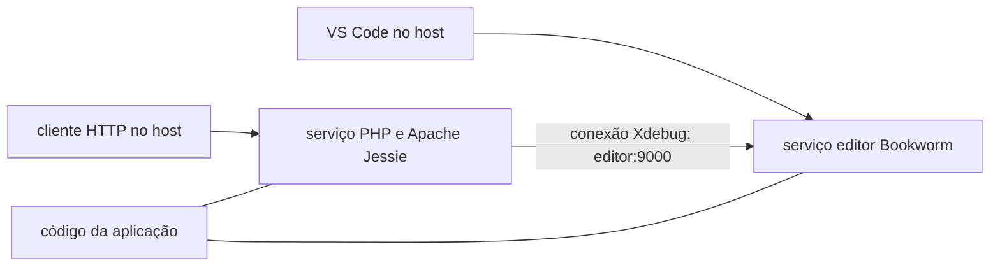

## Mais do que um container PHP

Um processo PHP executando em um container é apenas parte de um ambiente de desenvolvimento utilizável. O editor precisa se conectar, o depurador precisa alcançá-lo, os caminhos das fontes precisam coincidir e um breakpoint precisa realmente interromper a requisição.

Essa distinção orientou a criação de um pequeno catálogo de templates de Dev Containers para PHP 5.1.6, PHP 5.4 e PHP 8.5. O objetivo foi oferecer uma forma repetível de manter projetos legados enquanto se trabalha em direção a um runtime moderno, sem exigir que cada desenvolvedor reconstruísse uma toolchain antiga de PHP no host.

O resultado é um [repositório público de templates](https://github.com/guionardo/devcontainer-templates), três templates OCI, um instalador shell e três projetos mínimos testados com breakpoints reais no VS Code. Este artigo explica o design e as verificações que tornaram o resultado confiável.

## Um catálogo de templates com um limite claro

O repositório contém configuração de ambiente, verificações técnicas e pequenos exemplos em PHP. O código da aplicação e os testes de regressão de negócio permanecem em seus próprios repositórios.

Esse limite importa durante a modernização. Executar com sucesso um cálculo no PHP 5.1 e no PHP 8.5 prova algo útil sobre o ambiente. Não prova que as consultas ao banco de dados, o framework, as dependências ou as regras de negócio de uma aplicação se comportam de forma idêntica.

Cada runtime tem seu próprio diretório em `src/`, contendo `devcontainer-template.json`, `.devcontainer/devcontainer.json`, um Dockerfile e a configuração de debug. Os templates legados também contêm um arquivo Compose. Esses arquivos podem ser aplicados a um projeto existente, permitindo manter a configuração do ambiente junto da aplicação.

## Por que o editor legado precisa de seu próprio container

Os builds legados usam Debian Jessie. Os binários modernos do VS Code Server exigem bibliotecas do sistema mais novas do que as fornecidas por esse ambiente, incluindo glibc 2.28 ou posterior. Os [requisitos para Linux da Microsoft](https://code.visualstudio.com/docs/remote/linux) descrevem esse limite.

A solução foi separar as funções:

- Um serviço `editor` moderno, baseado em Bookworm, executa o VS Code Server e o PHP Debug.
- Um serviço `php` executa a versão histórica do PHP e o Apache.
- Ambos os serviços montam a aplicação em `/var/www/html`.
- O Xdebug se conecta do runtime ao `editor:9000` pela rede do Compose.



Manter o mesmo caminho de montagem simplifica o mapeamento das fontes. Manter o editor atual evita obrigar um sistema operacional antigo a atender aos requisitos de bibliotecas do editor.

Há uma troca visível: o terminal integrado legado pertence ao serviço `editor` e não tem um interpretador PHP. Os comandos do runtime são executados a partir do host:

```sh
docker compose -f .devcontainer/compose.yaml exec php php -v
```

O ambiente PHP 8.5 pode hospedar as duas funções no mesmo container; por isso, seu terminal integrado contém PHP e o Xdebug se conecta localmente pela porta 9003.

## Trate o SAPI do PHP e os downloads das fontes como escolhas explícitas

O PHP 5.1.6 usa CGI nesta configuração. Seu módulo histórico do Apache não é adequado à configuração escolhida do Apache 2.4. Os executáveis CLI e CGI precisam ser copiados dos artefatos de build corretos; um executável chamado `php` não contém informação suficiente para determinar sua função.

O PHP 5.4.45 usa um módulo do Apache com o MPM prefork. O ambiente moderno usa a imagem oficial do PHP 8.5 com Apache.

Os downloads das fontes foram outro limite de compatibilidade. O cliente TLS da distribuição antiga não conseguia negociar com o endpoint de download do Xdebug. Uma etapa separada com curl moderno baixa os arquivos do PHP histórico e do Xdebug com verificação de certificados e os repassa à etapa de build legada.

Isso resolve uma falha concreta de download. Não torna todo o build reproduzível. O repositório ainda precisa de checksums fixos dos arquivos, digests fixos das imagens e validação das dependências sem camadas em cache. Esses limites devem ficar documentados, em vez de serem escondidos atrás de um badge de build bem-sucedido.

## O Xdebug se conecta ao editor

O modelo de rede fica mais fácil de entender quando a direção da conexão é explícita. O runtime PHP inicia a conexão com o depurador, e o PHP Debug fica escutando.

No layout legado, `host.docker.internal` apontaria para o host, e não para o serviço editor. O destino configurado é, portanto, `editor:9000`. O listener fica dentro desse serviço, e o caminho compartilhado do workspace é mapeado para o workspace do editor.

No PHP 8.5, o editor e o runtime compartilham um container. O Xdebug se conecta a `127.0.0.1:9003`. As requisições usam `?XDEBUG_TRIGGER=1` para optar pelo debug. As configurações legadas selecionadas iniciam suas conexões do Xdebug automaticamente.

Nenhum desses layouts exige publicar explicitamente uma porta de debug no host. O host precisa acessar o servidor HTTP; a conexão do depurador permanece na rede de containers ou no container relevante.

## Distribua a configuração em um formato padrão

Copiar uma pasta `.devcontainer` é útil para um primeiro experimento. Uma equipe precisa de uma versão clara e de um caminho de instalação repetível.

Os Dev Container Templates fornecem esse formato. A [CLI oficial](https://github.com/devcontainers/cli/blob/main/docs/templates/apply.md) pode baixar um template OCI para um projeto existente:

```sh
npx @devcontainers/cli templates apply --workspace-folder . --template-id ghcr.io/guionardo/devcontainer-templates/php-5.4:0.1.0
```

O sufixo seleciona a versão do template. Ele é separado da versão do PHP e da versão da CLI baixada pelo npx. Depois de aplicar o template, o desenvolvedor abre a aplicação no VS Code e escolhe **Dev Containers: Reopen in Container**.

Os pacotes publicados contêm arquivos de configuração, não imagens PHP pré-construídas. O primeiro uso ainda faz o build do runtime localmente. Publicar imagens pré-construídas poderia reduzir esse custo, mas acrescentaria outro artefato de release para manter.

Os três templates produzem quatro pacotes no GHCR: um por runtime e um pacote de metadados da coleção. O pacote extra permite descoberta; não é um quarto ambiente PHP acidental. Esse comportamento é descrito no [template starter oficial](https://github.com/devcontainers/template-starter#publishing).

## Um instalador para projetos existentes e personalizados

O catálogo também fornece um instalador shell:

```sh
curl -fsSL https://raw.githubusercontent.com/guionardo/devcontainer-templates/main/scripts/install.sh | sh -s -- --php 5.4 --smoke
```

Ele pode ser executado no Git Bash, WSL, Linux ou macOS. Os desenvolvedores também podem baixar e inspecionar o script antes de executá-lo.

Um instalador precisa considerar a configuração existente. Este recusa um diretório `.devcontainer` existente, a menos que `--update` seja informado. As atualizações criam um backup, substituem os arquivos conhecidos do template, preservam `.env` e arquivos personalizados e deixam intacto um `launch.json` existente. Uma configuração de debug candidata é gravada separadamente para mesclagem manual.

Essa é uma estratégia de atualização intencionalmente limitada. Ela não tenta mesclar JSONC arbitrário nem preservar alterações personalizadas dentro de um Dockerfile que será substituído. Essas alterações precisam ser revisadas e reaplicadas a partir do backup. A CLI oficial é um caminho de instalação separado e não deve ser descrita como fornecendo essas salvaguardas personalizadas.

O instalador usa a fonte Git e assume `main` por padrão. Isso pode ser diferente da versão OCI mais recente. Uma tag ou commit fixo, usado tanto na URL do script quanto no argumento `--ref`, torna explícita a revisão da fonte selecionada.

## Publique pacotes a partir de tags

O repositório usa uma versão coordenada para os três templates. Isso é uma convenção do projeto; a especificação subjacente também permite versões independentes por template.

Uma tag como `v1.0.0` inicia a publicação somente se os três arquivos de metadados declararem `1.0.0` e o commit marcado pertencer ao histórico de `main`. O workflow primeiro executa o validador de release, os testes do instalador, as verificações JSON e a validação do Compose; depois chama a ação oficial de publicação com permissão de escrita em pacotes.

Para um release preparado, o mantenedor executa:

```sh
node scripts/validate-release.cjs v1.0.0
git tag -a v1.0.0 -m "Release Dev Container Templates 1.0.0"
git push origin v1.0.0
```

O marco `1.0.0` consolida o catálogo em inglês e a automação de release; os resultados manuais discutidos aqui pertencem à baseline publicada `0.1.0`. Uma alteração de documentação não é motivo para substituir silenciosamente uma versão de pacote existente.

## O que o teste manual realmente estabeleceu

A verificação ponta a ponta usou VS Code 1.143.1 no Windows x64 com Docker Desktop em modo Linux. Os pacotes OCI publicados foram baixados usando a CLI oficial incluída na extensão Dev Containers. O PHP Debug 1.40.2 foi instalado automaticamente em cada container editor.

| Runtime | Xdebug | Resposta HTTP | Breakpoint, variáveis e F10 |
| --- | --- | --- | --- |
| PHP 5.1.6 | 2.0.0 | Passou | Passou |
| PHP 5.4.45 | 2.4.1 | Passou | Passou |
| PHP 8.5.12 | 3.5.3 | Passou | Passou |

Cada aplicação mínima calcula um subtotal de 50, aplica um desconto de 5 e retorna 45. O breakpoint foi colocado antes da subtração. O VS Code parou na linha 7; as variáveis locais mostraram as entradas esperadas. F10 avançou para a linha 8 e exibiu o total 45. F5 concluiu a requisição e retornou a versão do PHP, a versão do Xdebug e o resultado do cálculo.

Isso exercitou mais do que um arquivo de configuração do depurador. Demonstrou a conexão do runtime com o editor, o mapeamento das fontes, a resolução do breakpoint, os frames da pilha, a inspeção de variáveis, a execução passo a passo e a continuação de uma requisição HTTP real.

O [relatório e as evidências](https://github.com/guionardo/devcontainer-templates/blob/main/examples/vscode-debug/RESULTS.md) distinguem a sessão manual original de alterações posteriores nos identificadores em inglês. Isso importa: editar um relatório não deve fabricar uma nova execução de teste.

## Um ambiente útil ainda tem limites

Esses ambientes apoiam a manutenção local isolada. Versões não suportadas do PHP e do Debian não se tornam adequadas para produção só porque executam em Docker. A baseline do PHP 5.1.6 também não tem o driver MySQL habilitado; portanto, uma aplicação pode precisar de trabalho adicional mesmo quando o exemplo mínimo de debug é bem-sucedido.

Atualmente, a CI valida a configuração, o comportamento do instalador e as regras de release. Ela não opera a interface gráfica do VS Code nem afirma substituir testes de regressão da aplicação. Outras plataformas e arquiteturas precisam de sua própria validação.

O resultado mais útil é um conjunto menor e explícito de premissas: qual runtime foi selecionado, onde o editor executa, em que direção o depurador se conecta, o que uma versão de template contém e quais verificações realmente passaram. Assim, os desenvolvedores podem dedicar mais tempo a investigar o comportamento da aplicação e menos tempo a reconstruir o ambiente ao redor dela.

## Referências

- [Repositório e templates](https://github.com/guionardo/devcontainer-templates)
- [Requisitos do VS Code para Linux](https://code.visualstudio.com/docs/remote/linux)
- [Especificação de Dev Container Templates](https://containers.dev/implementors/templates/)
- [CLI oficial: aplicar um template](https://github.com/devcontainers/cli/blob/main/docs/templates/apply.md)
- [Autoria de templates e pacotes de metadados](https://github.com/devcontainers/template-starter)
- [Ação de publicação](https://github.com/devcontainers/action)
