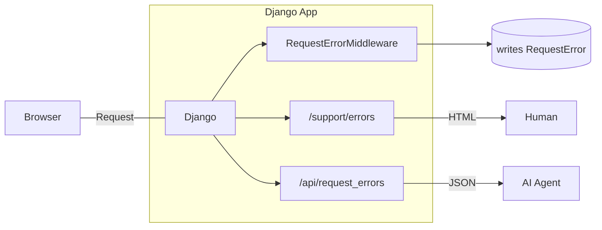

Every time a production error showed up on the support screen, the process was
the same: I opened the page, copied the error message, pasted it into a chat
with the AI, and asked for a diagnosis.

It worked. But it was slow, fragile, and depended on me at every step.

Then a `FileNotFoundError` on an operational-manuals screen made me see the
real problem: **I had no way to give the AI agent the ability to discover errors
on its own.** It only ever saw what I pasted.

The question that guided me was simple:

> How do I expose production errors as JSON, safely, so an AI agent can close
> the diagnosis-and-fix loop — with a human reviewing and approving the pull
> request before deploy?

The result is a small API with big decisions. Let me walk you through what I
built, why I built it that way, and what I learned.

---

## The problem: errors stuck on an HTML screen

The system is a Django application. Production errors were captured by a
middleware and written to a database, but the only way to see them was an HTML
screen protected by staff login.

Before going further, a piece of context that explains the size of the solution.
The application does not run on a big cloud. For cost reasons, it is hosted
**on-premise**, for **internal use**, but **publicly exposed on the internet**
for a few remote users. That means two things at once: production errors reach
real users on the outside — and there is no budget or team for an observability
platform. We have no APM, no distributed tracing, no metrics dashboard. What we
have is the application itself, the database it already uses, and this error API
that lives inside it. The limitation is not lack of time: it is the budget.

That created three limits:

- **No agent can discover errors on its own.** Without programmatic access, it
  depends on someone pasting the text.
- **You cannot filter by deploy.** Without knowing which release produced the
  error, it is impossible to answer "did this break after the last release?".
- **There is no tracking of what was fixed.** Nothing marks an error as solved.

What I wanted was the opposite: the agent **discovers**, **diagnoses** and
**proposes**; the human **reviews**, **approves** and **ships**.

---

## The solution in one sentence

A middleware captures every HTTP 500+ error and writes a structured record. A
JSON API, authenticated by an environment token, exposes those records to the
agent — with a sanitized stack trace, deploy identification, and the ability to
mark the error as fixed.



---

## What the agent can do

```
GET    /api/request_errors/?status=AB&limit=20   # open errors
GET    /api/request_errors/?boot_id=<deploy>     # what broke after deploy X
GET    /api/request_errors/{id}                  # detail
PATCH  /api/request_errors/{id}  {"status":"CO"} # mark as fixed
```

Four operations. Deliberately few: the destructive "clear history" action does
**not** exist in the API — only on the human screen.

---

## The decisions that matter (and why they matter)

### 1. Environment token, disabled by default

The global API uses a session cookie. An HTTP agent has no session. So the token
goes in a header (`X-API-Token`) and is compared in constant time
(`secrets.compare_digest`).

The most important detail: **without the environment variable set, the endpoint
responds 401.** The default state is "exposes nothing". Security by omission,
not by configuration.

### 2. The traceback is not cut from the end

This was the most interesting decision — and the one that taught me the most.

The first version of the traceback was truncated to 40 lines **cut from the
end**. The problem: the end of a Django stack trace is almost only
`django/db/backends`, which is where Django **re-raises** the error, not where it
**happened**.

The result: the agent got a pile of Django code and could not find the cause.
The fix started **keeping the project frames** (marked by `/editora/` or
`/editor_site/`), which sit at the **top** of the stack. If there is no project
frame, then it falls back to the last 40 lines — where the `raise` point is.

> How you cut the stack trace is a product decision. Delivering the wrong stack
> is the same as delivering no stack at all.

### 3. What goes into the payload (and what comes out)

The request context is stored complete in the database — the human screen needs
it. But at API delivery, two fields are **removed**:

- **`session`** — the session key allows hijacking the session of whoever made
  the request.
- **`body`** — it carries the request data, potentially sensitive.

Full storage, sanitized delivery. Different exposure levels for different
audiences.

### 4. `boot_id`: the filter that closes the loop

Each error carries the `boot_id` of the process that generated it. This lets the
agent answer the most important question in the deploy loop:

> "After I fixed and shipped it, **did the error stop**?"

Without this, confirming a fix depends on gut feeling.

### 5. Trusting the secret (explicitly)

The endpoint does **not** check `is_staff`. Whoever has the token sees every
user's errors. It is the same exposure level as the support screen, but via
secret.

It is a conscious trade-off: the token is the barrier. If it leaks, rotating the
variable disables access immediately.

---

## The full loop (what changes in practice)

```
 1. Agent: GET /api/request_errors/?status=AB
 2. Agent: reads traceback + endpoint + boot_id + context
 3. Agent: diagnoses the cause and writes the fix
 4. Agent: opens a Pull Request
 5. Human: reviews and approves
 6. Human: deploys
 7. Agent: GET /api/request_errors/?boot_id=<new_deploy>  → confirms it stopped
 8. Agent: PATCH /api/request_errors/{id}  {"status":"CO"}
```

The agent does discovery, diagnosis and proposal. The human keeps the decision.
This is what I call **automation with supervision**: the repetitive, reading-heavy
work comes off my plate; the final responsibility stays mine.

---

## In action: a conversation with the agent

Theory is nice. In practice, the loop starts with a simple sentence.

### The prompt

```
check the errors in the production environment
```

That's it. No ID, no link, no copy-paste of stack trace.

### What the agent does on its own

The agent loads the environment variables (`X_API_TOKEN`, `X_API_URL`), builds
the requests and queries the API directly:

```bash
# 1. Open errors — what needs attention now
curl -s -H "X-API-Token: $X_API_TOKEN" \
  "$X_API_URL/api/request_errors/?status=AB&limit=20"

# 2. Errors under analysis — did someone already look?
curl -s -H "X-API-Token: $X_API_TOKEN" \
  "$X_API_URL/api/request_errors/?status=AN&limit=10"

# 3. All errors — full picture
curl -s -H "X-API-Token: $X_API_TOKEN" \
  "$X_API_URL/api/request_errors/?limit=500"
```

### The agent's response

In seconds, it returns a structured analysis:

**Error Dashboard — Production (Fly.io)**

| Metric | Value |
|--------|-------|
| **Total** | 3 |
| 🟢 Open | 0 |
| 🟡 Under Analysis | 1 |
| 🔵 Fixed | 2 |

| ID | Date | Exception | Endpoint | Status | User | Boot ID |
|---|---|---|---|---|---|---|
| 3 | 15/10 11:50 | `FileNotFoundError` | `manual_operacao` | AN | guionardo | 1792075704 |
| 2 | 08/10 13:23 | `OperationalError` (database is locked) | `editora_pedidoitem_delete` | CO | Mara | 1790299626 |
| 1 | 09/09 10:39 | `FieldError` (icontains on FK) | `editora_contato_changelist` | CO | Akauana | 1788617182 |

### Diagnosis by error

**#3 — FileNotFoundError**
> The `manual_operacao` view tried to open `../../docs/MANUAL_OPERACIONAL.md`
> from `/app/editora/views/`. In the Fly.io container, the relative path does
> not resolve. The file was likely not included in the Docker image.
> *Suggestion: use an absolute path via settings, or include the file in the build.*

**#2 — database is locked**
> SQLite write lock during `PedidoItem` deletion via admin. The traceback is
> truncated to project frames — here the relevant one is
> `django/db/backends/sqlite3/base.py:360`, where the lock blew after 30
> seconds. Since it was an isolated error, it indicates a long transaction, not
> a systemic event.
> *Suggestion: monitor for recurrence; investigate transactions in `exclusoes.py`.*

**#1 — FieldError**
> Admin search `q=luana` on the Contact admin used `icontains` on a ForeignKey.
> Django rejects a direct `icontains` lookup on FK.
> *Suggestion: review the admin `search_fields`, use `cliente__nome__icontains`.*

### The point that matters

The user did not need to open a screen, did not copy anything, did not translate
`boot_id` into a deploy date. The agent bridged the gap between a natural
language question and structured API commands. The human received context,
hypotheses and suggested actions — not raw JSON.

---

## What I learned

1. **Exposing an error as JSON is exposing a stack trace, a file name and user
   context.** There is no zero exposure — there is exposure controlled by a
   secret, with the minimum in the payload.
2. **The "boring" detail is what breaks automation.** The agent did not fail for
   lack of intelligence; it failed because the delivered traceback had no project
   frame. The tool was wrong, not the agent.
3. **Disabling by default is a feature.** An endpoint that responds 401 without
   configuration is an endpoint that never leaks by forgetfulness.
4. **Destructive actions do not belong in the API.** If the agent can erase
   history, a diagnosis mistake becomes data loss.
5. **Objective confirmation is worth gold.** The `boot_id` turns "I think it's
   fixed" into "the error stopped after this deploy".
6. **Budget is a design constraint.** Not buying an observability platform was
   not laziness: it was a decision. That pushed the solution inside the
   application, where it costs almost nothing and solves the real problem.

---

## Honest limitations

None of this is perfect, and it is worth saying — and, to be fair, these are
limitations coherent with the budget and the project's size, not a lack of time:

- It only captures **500+** errors. 4xx errors are not recorded (by design).
- Deduplication uses `unique_together`, so a recurring error **does not update**
  the last-occurrence date — only the first one is kept.
- There is no webhook: the agent has to poll.
- The `endpoint` field stores the **route name**, not the path — a detail that
  already caught me out (and that I documented).

---

## Conclusion

Building an error API for AI agents looked like a "how do I expose this as JSON"
problem. In practice, it was a **how much** to expose, **to whom**, and **with
what confirmation** problem.

The feature is small. The decisions are not. And the real win was not "the agent
found an error" — it was **me no longer being the middleman between the error and
the fix**.

If you work with AI agents in production, my suggestion is: start with
observability. An agent without structured access to errors is an agent guessing.
And if the budget is tight, remember: you do not need an observability platform
to give the agent what it needs — sometimes a 100-line API inside the application
itself does the job.

---

**You? How do your AI agents discover errors in production? Do they paste stack
traces by hand, or do you already have an API for that? Tell me in the comments.**