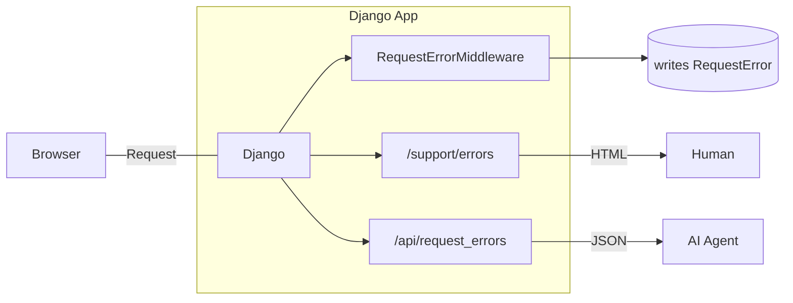

Cada vez que aparecía un error de producción en la pantalla de soporte del
sistema, el proceso era el mismo: abría la página, copiaba el mensaje de error,
lo pegaba en la conversación con la IA y pedía un diagnóstico.

Funcionaba. Pero era lento, frágil y dependía de mí en cada eslabón.

Hasta que un `FileNotFoundError` en una pantalla de manuales operacionales me
hizo ver el problema real: **no tenía forma de darle al agente de IA la
capacidad de descubrir los errores por sí solo.** Solo veía lo que yo pegaba.

La pregunta que me guió fue simple:

> ¿Cómo exponer los errores de producción en JSON, de forma segura, para que un
> agente de IA cierre el ciclo de diagnóstico y corrección — con un humano
> revisando y aprobando el pull request antes del deploy?

El resultado es una API pequeña, con decisiones grandes. Voy a contar qué
construí, por qué lo construí así y qué aprendí en el camino.

---

## El problema: errores atrapados en una pantalla HTML

El sistema es una aplicación Django. Los errores de producción eran capturados
por un middleware y guardados en una base de datos, pero la única forma de verlos
era una pantalla HTML protegida por login de staff.

Antes de seguir, un contexto que explica el tamaño de la solución. La aplicación
no corre en una nube grande. Por ahorro, está alojada **on-premise**, para **uso
interno**, pero **expuesta públicamente en internet** para algunos usuarios que
trabajan de forma remota. Eso significa dos cosas al mismo tiempo: los errores de
producción llegan a usuarios reales del lado de afuera — y no hay presupuesto ni
equipo para una plataforma de observabilidad. No tenemos APM, tracing distribuido
ni dashboard de métricas. Lo que tenemos es la propia aplicación, la base de datos
que ya usa y esta API de errores que vive dentro de ella. La limitación no es
falta de tiempo: es el presupuesto.

Eso creaba tres límites:

- **Ningún agente puede descubrir errores solo.** Sin acceso programático,
  depende de que alguien pegue el texto.
- **No se puede filtrar por deploy.** Sin saber de qué publicación vino el
  error, era imposible responder "¿esto se rompió después de la última
  publicación?".
- **No hay seguimiento de lo que se corrigió.** Nada marcaba un error como
  resuelto.

Lo que yo quería era lo contrario: el agente **descubre**, **diagnostica** y
**propone**; el humano **revisa**, **aprueba** y **publica**.

---

## La solución en una frase

Un middleware captura todo error HTTP 500+ y guarda un registro estructurado. Una
API JSON, autenticada por token de entorno, expone esos registros al agente —
con stack trace sanitizado, identificación del deploy y la posibilidad de marcar
el error como corregido.

```
 navegador ──▶ Django
                  ├─ RequestErrorMiddleware  → graba RequestError
                  ├─ /support/errors         → humano (HTML)
                  └─ /api/request_errors     → agente de IA (JSON)
```

---

## Lo que el agente puede hacer

```
GET    /api/request_errors/?status=AB&limit=20   # errores abiertos
GET    /api/request_errors/?boot_id=<deploy>     # lo que se rompió después del deploy X
GET    /api/request_errors/{id}                  # detalle
PATCH  /api/request_errors/{id}  {"status":"CO"} # marcar como corregido
```

Cuatro operaciones. Pocas a propósito: la acción destructiva de limpiar el
historial **no** existe en la API — solo en la pantalla humana.

---

## Las decisiones que importan (y por qué importan)

### 1. Token de entorno, deshabilitado por defecto

La API global usa cookie de sesión. Un agente HTTP no tiene sesión. Entonces el
token va en un header (`X-API-Token`) y se compara en tiempo constante
(`secrets.compare_digest`).

El detalle más importante: **sin la variable de entorno configurada, el endpoint
responde 401.** El estado por defecto es "no expone nada". Seguridad por
omisión, no por configuración.

### 2. El traceback no se corta por el final

Esta fue la decisión más interesante — y la que más me enseñó.

La primera versión del traceback se truncaba a 40 líneas **cortando por el
final**. El problema: el final del stack trace de Django es casi solo
`django/db/backends`, que es donde Django **re-lanza** el error, no donde
**ocurrió**.

Resultado: el agente recibía un montón de código de Django y no lograba hallar
la causa. El fix pasó a **mantener los frames del proyecto** (marcados por
`/editora/` o `/editor_site/`), que quedan en el **inicio** del stack. Sin
ningún frame del proyecto, ahí sí cae a las últimas 40 líneas — donde está el
punto del `raise`.

> Cómo cortas el stack trace es una decisión de producto. Entregar el stack
> equivocado es lo mismo que no entregar stack ninguno.

### 3. Lo que entra en el payload (y lo que sale)

El contexto de la solicitud se graba completo en la base de datos — la pantalla
humana lo necesita. Pero en la entrega por la API, dos campos se **eliminan**:

- **`session`** — la clave de sesión permite secuestrar la sesión de quien hizo
  la solicitud.
- **`body`** — carga los datos de la solicitud, posiblemente sensibles.

Grabación completa, entrega sanitizada. Son niveles de exposición diferentes
para públicos diferentes.

### 4. `boot_id`: el filtro que cierra el ciclo

Cada error carga el `boot_id` del proceso que lo generó. Eso le permite al agente
responder a la pregunta más importante del ciclo de deploy:

> "Después de que corregí y publiqué, **¿el error paró**?"

Sin eso, la confirmación de la corrección depende de corazonadas.

### 5. Confiar en el secreto (de forma explícita)

El endpoint **no** verifica `is_staff`. Quien tenga el token ve los errores de
todos los usuarios. Es el mismo nivel de exposición de la pantalla de soporte,
pero vía secreto.

Es un compromiso consciente: el token es la barrera. Si se filtra, rotar la
variable deshabilita el acceso inmediatamente.

---

## El ciclo completo (lo que cambia en la práctica)

```
 1. Agente: GET /api/request_errors/?status=AB
 2. Agente: lee traceback + endpoint + boot_id + contexto
 3. Agente: diagnostica la causa y escribe la corrección
 4. Agente: abre un Pull Request
 5. Humano: revisa y aprueba
 6. Humano: hace el deploy
 7. Agente: GET /api/request_errors/?boot_id=<nuevo_deploy>  → confirma que paró
 8. Agente: PATCH /api/request_errors/{id}  {"status":"CO"}
```

El agente hace descubrimiento, diagnóstico y propuesta. El humano se queda con
la decisión. Eso es lo que llamo **automatización con supervisión**: el trabajo
repetitivo y de lectura sale de mis espaldas; la responsabilidad final sigue
siendo mía.

---

## Lo que aprendí

1. **Exponer un error en JSON es exponer stack trace, nombre de archivo y
   contexto de usuario.** No existe exposición cero — existe exposición controlada
   por secreto, con el mínimo en el payload.
2. **El detalle "aburrido" es el que rompe la automatización.** El agente no
   falló por falta de inteligencia; falló porque el traceback entregado no tenía
   el frame del proyecto. La herramienta estaba mal, no el agente.
3. **Deshabilitar por defecto es una feature.** Un endpoint que responde 401 sin
   configuración es un endpoint que nunca se filtra por olvido.
4. **La acción destructiva no pertenece a la API.** Si el agente puede borrar
   historial, un error de diagnóstico se convierte en pérdida de datos.
5. **La confirmación objetiva vale oro.** El `boot_id` transforma "creo que se
   resolvió" en "el error paró después de este deploy".
6. **El presupuesto es un requisito de diseño.** No comprar una plataforma de
   observabilidad no fue pereza: fue decisión. Eso empujó la solución hacia
   dentro de la aplicación, donde cuesta casi nada y resuelve el problema real.

---

## Limitaciones honestas

Nada de esto es perfecto, y vale la pena decirlo — y, siendo justo, son
limitaciones coherentes con el presupuesto y el tamaño del proyecto, no falta de
tiempo:

- Solo captura errores **500+**. Los errores 4xx no entran (por decisión).
- La deduplicación usa `unique_together`, así que un error recurrente **no
  actualiza** la fecha de la última ocurrencia — solo se guarda la primera.
- No hay webhook: el agente necesita hacer polling.
- El campo `endpoint` guarda el **nombre de la ruta**, no el path — detalle que
  ya me agarró (y que documenté).

---

## Conclusión

Construir una API de errores para agentes de IA parecía un problema de "cómo
expongo esto en JSON". En la práctica, era un problema de **cuánto** exponer,
**para quién** y **con qué confirmación**.

La feature es pequeña. Las decisiones, no. Y la ganancia real no fue "el agente
descubrió un error" — fue **dejar de ser el intermediario entre el error y la
corrección**.

Si trabajas con agentes de IA en producción, mi sugerencia es: empieza por la
observabilidad. Un agente sin acceso estructurado a los errores es un agente
adivinando. Y si el presupuesto es corto, recuerda: no hace falta una plataforma
de observabilidad para darle al agente lo que necesita — a veces, una API de 100
líneas dentro de la propia aplicación resuelve.

---

**¿Y tú? ¿Cómo descubren errores en producción tus agentes de IA? ¿Pegan stack
traces a mano o ya tienen una API para eso? Cuéntame en los comentarios.**