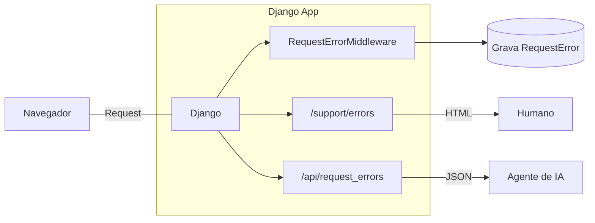

Toda vez que um erro de produção aparecia na tela de suporte do sistema, o
processo era o mesmo: eu abria a página, copiava a mensagem de erro, colava na
conversa com a IA e pedia um diagnóstico.

Funcionava. Mas era lento, frágil e dependia de mim em cada elo.

Aí veio um `FileNotFoundError` numa tela de manuais operacionais que me fez
perceber o problema real: **eu não tinha como dar ao agente de IA a capacidade
de descobrir os erros sozinho.** Ele só via o que eu colasse.

A pergunta que me guiou foi simples:

> Como expor os erros de produção em JSON, de forma segura, para que um agente
> de IA feche o ciclo de diagnóstico e correção — com um humano revisando e
> aprovando o pull request antes do deploy?

O resultado é uma API pequena, com decisões grandes. Vou contar o que construí,
por que construí assim e o que aprendi no caminho.

---

## O problema: erros presos numa tela HTML

O sistema é uma aplicação Django. Os erros de produção eram capturados por um
middleware e gravados num banco de dados, mas a única forma de vê-los era uma
tela HTML protegida por login de staff.

Antes de continuar, um contexto que explica o tamanho da solução. A aplicação
não roda numa cloud grande. Por economia, ela é hospedada **on-premise**, para
**uso interno**, mas **exposta publicamente na internet** para alguns usuários
que trabalham remotamente. Isso significa duas coisas ao mesmo tempo: os erros de
produção chegam a usuários reais do lado de fora — e não há orçamento nem time
para uma plataforma de observabilidade. Não temos APM, tracing distribuído ou
dashboard de métricas. O que temos é a própria aplicação, o banco que ela já
usa e esta API de erros que vive dentro dela. A limitação não é falta de tempo:
é o orçamento.

Isso criava três limites:

- **Nenhum agente consegue descobrir erros sozinho.** Sem acesso programático,
  ele depende de alguém colar o texto.
- **Não dá para filtrar por deploy.** Sem saber de qual publicação o erro vinha,
  era impossível responder "isto quebrou depois da última publicação?".
- **Não há rastreio do que foi corrigido.** Nada marcava um erro como resolvido.

O que eu queria era o inverso: o agente **descobre**, **diagnostica** e
**propõe**; o humano **revisa**, **aprova** e **publica**.

---

## A solução em uma frase

Um middleware captura todo erro HTTP 500+ e grava um registro estruturado. Uma
API JSON, autenticada por token de ambiente, expõe esses registros para o
agente — com stack trace saneado, identificação do deploy e a possibilidade de
marcar o erro como corrigido.



---

## O que o agente consegue fazer

```
GET    /api/request_errors/?status=AB&limit=20   # erros abertos
GET    /api/request_errors/?boot_id=<deploy>     # o que quebrou depois do deploy X
GET    /api/request_errors/{id}                  # detalhe
PATCH  /api/request_errors/{id}  {"status":"CO"} # marcar como corrigido
```

Quatro operações. É pouco de propósito: a ação destrutiva de limpar o histórico
**não** existe na API — só na tela humana.

---

## As decisões que interessam (e por que interessam)

### 1. Token de ambiente, desabilitado por padrão

A API global usa cookie de sessão. Um agente HTTP não tem sessão. Então o token
vai num header (`X-API-Token`) e é comparado em tempo constante
(`secrets.compare_digest`).

O detalhe mais importante: **sem a variável de ambiente configurada, o endpoint
responde 401.** O estado padrão é "não expõe nada". Segurança por omissão, não
por configuração.

### 2. O traceback não é cortado pelo fim

Essa foi a decisão mais interessante — e a que mais me ensinou.

A primeira versão do traceback era truncada para 40 linhas **cortando pelo fim**.
O problema: o fim do stack trace do Django é quase só `django/db/backends`, que
é onde o Django **re-lança** o erro, não onde ele **aconteceu**.

Resultado: o agente recebia um monte de código do Django e não conseguia achar a
causa. O fix passou a **manter os frames do projeto** (marcados por `/editora/`
ou `/editor_site/`), que ficam no **topo** do stack. Sem nenhum frame do
projeto, aí sim cai para as últimas 40 linhas — onde está o ponto do `raise`.

> Como você corta o stack trace é uma decisão de produto. Entregar o stack errado
> é o mesmo que não entregar stack nenhum.

### 3. O que entra no payload (e o que sai)

O contexto da requisição é gravado completo no banco — a tela humana precisa
disso. Mas na entrega pela API, dois campos são **removidos**:

- **`session`** — a chave da sessão permite sequestrar a sessão de quem fez a
  requisição.
- **`body`** — carrega os dados da requisição, possivelmente sensíveis.

Gravação completa, entrega saneada. São níveis de exposição diferentes para
públicos diferentes.

### 4. `boot_id`: o filtro que fecha o ciclo

Cada erro carrega o `boot_id` do processo que o gerou. Isso permite ao agente
responder a pergunta mais importante do ciclo de deploy:

> "Depois que eu corrigi e publiquei, **o erro parou**?"

Sem isso, a confirmação de correção depende de achismo.

### 5. Confiar no segredo (de forma explícita)

O endpoint **não** verifica `is_staff`. Quem tem o token vê os erros de todos os
usuários. É o mesmo nível de exposição da tela de suporte, mas via segredo.

É um trade-off consciente: o token é a barreira. Se vazar, rotacionar a
variável desativa o acesso imediatamente.

---

## O ciclo completo (o que muda na prática)

```
 1. Agente: GET /api/request_errors/?status=AB
 2. Agente: lê traceback + endpoint + boot_id + contexto
 3. Agente: diagnostica a causa e escreve a correção
 4. Agente: abre um Pull Request
 5. Humano: revisa e aprova
 6. Humano: faz o deploy
 7. Agente: GET /api/request_errors/?boot_id=<novo_deploy>  → confirma que parou
 8. Agente: PATCH /api/request_errors/{id}  {"status":"CO"}
```

O agente faz descoberta, diagnóstico e proposta. O humano fica com a decisão.
Isso é o que eu chamo de **automação com supervisão**: o trabalho repetitivo e
de leitura sai das minhas costas; a responsabilidade final continua minha.

---

## Em ação: uma conversa com o agente

A teoria é bonita. Na prática, o ciclo começa com uma frase simples.

### O prompt

```
verifique os erros no ambiente de produção
```

Isso é tudo. Nenhum ID, nenhum link, nenhum copy-paste de stack trace.

### O que o agente faz sozinho

O agente carrega as variáveis de ambiente (`X_API_TOKEN`, `X_API_URL`), monta
as chamadas e consulta a API diretamente:

```bash
# 1. Erros abertos — o que precisa de atenção agora
curl -s -H "X-API-Token: $X_API_TOKEN" \
  "$X_API_URL/api/request_errors/?status=AB&limit=20"

# 2. Erros em análise — alguém já olhou?
curl -s -H "X-API-Token: $X_API_TOKEN" \
  "$X_API_URL/api/request_errors/?status=AN&limit=10"

# 3. Todos os erros — panorama completo
curl -s -H "X-API-Token: $X_API_TOKEN" \
  "$X_API_URL/api/request_errors/?limit=500"
```

### A resposta do agente

Em segundos, ele devolve uma análise estruturada:

**Dashboard de Erros — Produção (Fly.io)**

| Métrica | Valor |
|---------|-------|
| **Total** | 3 |
| 🟢 Abertos | 0 |
| 🟡 Analisados | 1 |
| 🔵 Corrigidos | 2 |

| ID | Data | Exceção | Endpoint | Status | Usuário | Boot ID |
|---|---|---|---|---|---|---|
| 3 | 15/10 11:50 | `FileNotFoundError` | `manual_operacao` | AN | guionardo | 1792075704 |
| 2 | 08/10 13:23 | `OperationalError` (database is locked) | `editora_pedidoitem_delete` | CO | Mara | 1790299626 |
| 1 | 09/09 10:39 | `FieldError` (icontains em FK) | `editora_contato_changelist` | CO | Akauana | 1788617182 |

### Diagnóstico por erro

**#3 — FileNotFoundError**
> A view `manual_operacao` tentou abrir `../../docs/MANUAL_OPERACIONAL.md` a
> partir de `/app/editora/views/`. No container Fly.io, o path relativo não
> resolve. O arquivo provavelmente não foi incluído na imagem Docker.
> *Sugestão: usar path absoluto via settings ou incluir o arquivo no build.*

**#2 — database is locked**
> Lock de escrita no SQLite durante exclusão de `PedidoItem` pelo admin. O
> traceback corta nos frames do projeto — neste caso, o relevante é
> `django/db/backends/sqlite3/base.py:360`, onde o lock estourou depois de
> 30 segundos. Como foi erro isolado, indica transação longa, não evento
> sistêmico.
> *Sugestão: monitorar recorrência; investigar transações em `exclusoes.py`.*

**#1 — FieldError**
> Busca `q=luana` no admin de Contato usou `icontains` em ForeignKey. O Django
> rejeita lookup `icontains` direto em FK. 
> *Sugestão: revisar `search_fields` do admin, usar `cliente__nome__icontains`.*

### O ponto que importa

O usuário não precisou abrir uma tela, não copiou nada, não traduziu
`boot_id` para data de deploy. O agente fez a ponte entre a pergunta em
linguagem natural e os comandos estruturados na API. O humano recebeu
contexto, hipóteses e ações sugeridas — não um JSON cru.

---

## O que eu aprendi

1. **Expor erro em JSON é expor stack trace, nome de arquivo e contexto de
   usuário.** Não existe exposição zero — existe exposição controlada por
   segredo, com o mínimo no payload.
2. **O detalhe "chato" é o que quebra a automação.** O agente não falhou por
   falta de inteligência; falhou porque o traceback entregue não tinha o frame
   do projeto. A ferramenta estava errada, não o agente.
3. **Desabilitar por padrão é uma feature.** Um endpoint que responde 401 sem
   configuração é um endpoint que nunca vaza por esquecimento.
4. **Ação destrutiva não pertence à API.** Se o agente pode apagar histórico, um
   erro de diagnóstico vira perda de dados.
5. **A confirmação objetiva vale ouro.** O `boot_id` transforma "acho que
   resolveu" em "o erro parou depois deste deploy".
6. **O orçamento é um requisito de design.** Não comprar uma plataforma de
   observabilidade não foi preguiça: foi decisão. Isso empurrou a solução para
   dentro da aplicação, onde ela custa quase nada e resolve o problema real.

---

## Limitações honestas

Nada disso é perfeito, e vale dizer — e, sendo justo, são limitações coerentes
com o orçamento e o tamanho do projeto, não falta de tempo:

- Só captura erros **500+**. Erros 4xx não entram (por decisão).
- A deduplicação usa `unique_together`, então um erro recorrente **não atualiza**
  a data da última ocorrência — só a primeira é guardada.
- Não há webhook: o agente precisa fazer polling.
- O campo `endpoint` guarda o **nome da rota**, não o caminho — detalhe que já
  me pegou (e que documentei).

---

## Conclusão

Construir uma API de erros para agentes de IA parecia um problema de "como
exponho isto em JSON". Na prática, era um problema de **quanto** expor, **para
quem** e **com que confirmação**.

A feature é pequena. As decisões, não. E o ganho real não foi "o agente
descobriu um erro" — foi **eu deixar de ser o intermediário entre o erro e a
correção**.

Se você trabalha com agentes de IA em produção, minha sugestão é: comece pelo
observability. Um agente sem acesso estruturado aos erros é um agente adivinhando.
E se o orçamento é curto, lembre-se: não é preciso uma plataforma de
observabilidade para dar ao agente o que ele precisa — às vezes, uma API de 100
linhas dentro da própria aplicação resolve.

---

**E você? Como seus agentes de IA descobrem erros em produção? Colam stack
trace à mão ou já têm uma API para isso? Conta nos comentários.**